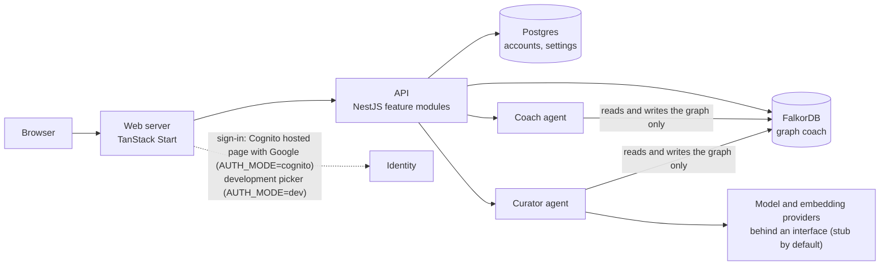
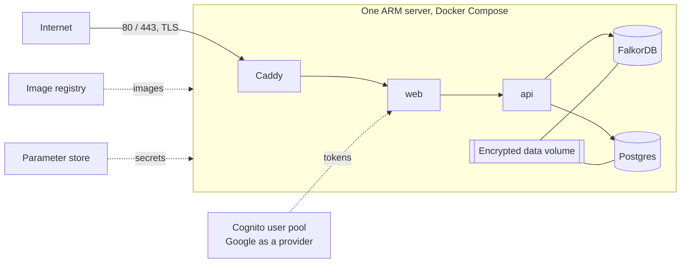
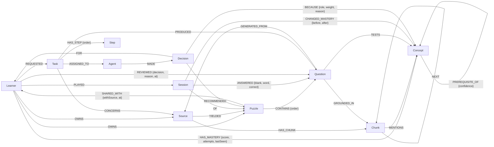

# Graph Coach

A study coach whose memory is a FalkorDB knowledge graph: learners play fill-in-the-blank puzzles built from a prompt or from their own material, and agents decide what to practise next and show the path behind every decision.

Track: **Agent Memory and Coordination**. Live site: **https://graphcoach.interfacesdigitais.com.br**. Demo video: link in the submission. Read [Provenance](#16-provenance) before judging this entry.

## 1a. Live site

**https://graphcoach.interfacesdigitais.com.br** (AWS; deployed 2026-10-17; the smoke check passed on every deploy).

- **Sign in** with your own Google account (a fresh learner with the free monthly allowance) or with an e-mail and password.
- **Demo logins** for the seeded Databases 101 scenario: `learner@example.test` (has the weak-prerequisite history, best for "What next?" and "Why this?"), `learner2@example.test`, and `reviewer@example.test`, via "Sign in with e-mail". The password is given in the submission form only, never here.
- **Try:** play a puzzle, ask the Coach "What next?" and open "Why this?"; create a puzzle from a prompt or upload a PDF/Word/text file and review the drafts.
- The site is a demonstration: synthetic seed content, may be reset, and may be stopped outside the judging period. If it is down, use the local setup in section 4.

## 2. Overview

Agents that help a learner usually forget the earlier sessions, miss how topics relate to each other, and cannot say why they suggested what they did. Graph Coach keeps all of that in one FalkorDB graph and reads it back with named Cypher queries.

- **Play.** A learner opens a fill-in-the-blank puzzle, fills the blanks from a word bank, and submits. The server grades it; the answer key never reaches the browser.
- **Remember.** Every answer is stored as an edge, and a mastery score per concept is updated on submit (`HAS_MASTERY`, `ANSWERED`, `CHANGED_MASTERY`). The next session starts from that memory, not from scratch.
- **Recommend with a path.** The Coach agent walks the prerequisite graph upstream from the concepts the learner is weak on, picks a target concept and a puzzle the learner is allowed to play, and stores a `Decision` with `BECAUSE` edges to its evidence. "Why this?" reads that subgraph back.
- **Ingest.** The Curator agent turns the learner's own text into passages with embeddings, extracts concepts, links them to the existing concept map, and drafts questions grounded in a passage. Run state lives in the graph (`Task`, `Step`) so a run can resume after a restart.
- **Review.** The owner approves or rejects each draft; a puzzle is published when enough questions are approved. The owner may share it with chosen users, with or without the source.

The Coach and the Curator never call each other. They meet only in graph nodes (see [Agents](#8-agents)). Postgres holds accounts and admin settings only; everything about knowledge, play, and agents is in the graph.

## 2a. Two ways to create a puzzle

**From a prompt.** No upload. The learner gives a subject, a focus, a difficulty, and a length. A planner, a writer, and a critic work in separate steps (`outline`, `draftQuestions`, `critique`, `refine` for one rewrite, `validate`), each recorded as a `Step` in the graph; the critic's verdict and note stay on each draft question (`critiqueVerdict`, `critiqueNote`). The brief is stored on a `Source` of kind `prompt`, and each question keeps a `GENERATED_FROM` edge to it. Such puzzles carry `origin = 'prompt'`, are labelled "Generated from a prompt, not checked against a source", never show a passage, make no embedding call, and still need their owner's approval before they are published.

**From uploaded material.** The text is split into passages (`Chunk`) with embeddings, concepts and prerequisites are extracted and linked to the existing map, and every question is grounded in a passage (`GROUNDED_IN`) that the learner can read back.

**Why uploads are stronger.** Answers are checked against the passage, the passage is shown next to a missed blank (to a caller who may read the source), and the Coach can use it as evidence. The critic lowers the risk of invented content in a prompt-made puzzle but cannot remove it without a source.

**Allowance.** Defaults, all editable in the admin settings: three uploads and three prompt creations per account per calendar month (`monthlySourceAllowance`, `monthlyPromptAllowance`), at most five creations per hour (`hourlyCreationLimit`), and a switch that pauses creation (`creationEnabled`). Access codes grant more runs and are redeemed once per account; only a hash of a code is stored.

## 3. Architecture

Application:



Deployment (the design; nothing is deployed yet):



The deployment diagram is the plan in `the design documents/`; the infrastructure files it needs do not exist in this repository yet.

**What lives where.** FalkorDB (graph `coach`) holds learners, concepts and their prerequisites, sources and passages with embeddings, puzzles and questions, sessions and answers, mastery, decisions and their evidence, and the tasks and steps of the Curator. Postgres holds only the `users`, `user_identities`, `access_codes`, `code_redemptions`, and `admin_settings` tables. E-mail addresses are in Postgres only. The web server holds no data of its own. The API checks the access token on every request.

## 4. Setup (local fallback and development)

The local setup needs no identity provider and no internet. With `AUTH_MODE=dev` the web app shows a "Development sign-in" picker of the four seeded demo accounts, and no password is asked. Providers are `stub` by default, so no model key is needed and drafts are canned.

| Tool                   | Version                                                                                                     | Check                    |
| ---------------------- | ----------------------------------------------------------------------------------------------------------- | ------------------------ |
| Node.js                | 22.12 or later (24 recommended, see `.nvmrc`; the API loads the ESM-only workspace packages with `require`) | `node --version`         |
| pnpm                   | 9 or later                                                                                                  | `pnpm --version`         |
| Docker with Compose v2 | any recent                                                                                                  | `docker compose version` |
| GNU Make               | any                                                                                                         | `make --version`         |

| Port | Used by             |
| ---- | ------------------- |
| 3000 | web app             |
| 3001 | API                 |
| 3002 | FalkorDB browser UI |
| 5432 | Postgres            |
| 6379 | FalkorDB            |

```bash
make setup    # checks prerequisites, installs dependencies, creates .env from .env.example
make up       # starts FalkorDB (6379, browser UI on 3002) and Postgres (5432), waits until healthy
make migrate  # Postgres migrations, then graph setup
make seed     # loads the synthetic seed content
make dev      # builds the packages, then runs the API (3001) and the web app (3000) in watch mode
make reset    # empties the graph and accounts after you type the graph name; then run make migrate seed
make doctor   # checks tools, ports, and .env keys
make down     # stops the stores, keeps their data
```

Image versions: `falkordb/falkordb:6.0.2`, `postgres:16.15-alpine`. `GET /api/health` reporting the graph and database as `ok` means the stores are reachable, not that `make migrate` has run.

### Walkthrough

These are instructions. The ten steps have not been followed from a clean checkout with a timer, so no timing is recorded here: **clean-checkout timing: not yet run.**

| #   | Command or action                                                                                        | Expected outcome                                                                                                                                                                                     |
| --- | -------------------------------------------------------------------------------------------------------- | ---------------------------------------------------------------------------------------------------------------------------------------------------------------------------------------------------- |
| 1   | Clone the repository and enter it                                                                        | A working tree with `Makefile`, `.env.example`, `infra/`, `apps/`, `packages/`                                                                                                                       |
| 2   | `make setup`                                                                                             | One line per tool, all passing; dependencies install; `.env` is created from `.env.example`. A missing tool is named and the command stops                                                           |
| 3   | `make up`                                                                                                | Containers `falkordb` and `postgres` are running and healthy. The first run pulls two images                                                                                                         |
| 4   | `make migrate`                                                                                           | Postgres tables exist; graph `coach` has its indexes, constraints, and vector index. Running it again changes nothing                                                                                |
| 5   | `make seed`                                                                                              | 25 concepts, six public puzzles, four demo accounts, two `Agent` nodes, and the `learner` account's scenario sessions. Running it again creates nothing new                                          |
| 6   | `make dev`                                                                                               | Packages are built once; API on `http://localhost:3001`, web on `http://localhost:3000`. With a `stub` provider the API prints a banner naming it                                                    |
| 7   | Open `http://localhost:3001/api/health`                                                                  | `{"api":"ok","graph":"ok","sql":"ok"}`                                                                                                                                                               |
| 8   | Open `http://localhost:3000`. Under "Development sign-in", choose the first demo learner in "Sign in as" | The puzzle list shows six puzzles, each marked "Public"                                                                                                                                              |
| 9   | Play "Databases 101: Indexes and Query Planning", get some blanks wrong, click "Submit answers"          | A score, a per-blank review, and mastery before and after for each concept                                                                                                                           |
| 10  | Go to the Coach, click "What next?", then "Why this?"                                                    | Target B-trees and the puzzle "Databases 101: Storage and B-trees" (the seeded scenario: weak on `indexes`, weaker on its prerequisite `b-trees`); a path view with the earlier sessions as evidence |

Steps 1 to 10 are the intended 15-minute path. Optional steps: `make graph-ui` and open `http://localhost:3002`, select graph `coach`, and run `MATCH (c:Concept) RETURN count(c)` (expect 25); `make graph-shell` for `redis-cli` inside the FalkorDB container; create a puzzle from a prompt or from a file in `seed/sources/` on `/sources/new`, watch the task page, and approve three drafts to publish it; share it from `/puzzles` with `learner2@example.test` (that account must have signed in once); sign in as the admin and open `/admin`.

### Demo accounts

Accounts are identified by e-mail; there are no usernames. The picker offers `learner@example.test`, `learner2@example.test`, `reviewer@example.test`, and `admin@example.test` (short names `learner`, `learner2`, `reviewer`, `admin`), all in the reserved `.test` domain.

### Environment variables

One root `.env` (copied from `.env.example`) serves the API, the CLI, the web server, and docker compose. The API and CLI read `process.env` only. Full rules: `the design documents` section 2.

| Group                             | Variables                                                                                                                                                                                                                         | Notes                                                                                                                                                                                                              |
| --------------------------------- | --------------------------------------------------------------------------------------------------------------------------------------------------------------------------------------------------------------------------------- | ------------------------------------------------------------------------------------------------------------------------------------------------------------------------------------------------------------------ |
| Runtime                           | `NODE_ENV`, `LOG_LEVEL`, `API_PORT`, `WEB_ORIGIN`, `TRUST_PROXY`                                                                                                                                                                  | `WEB_ORIGIN` is the one CORS origin; `TRUST_PROXY` is also read by the web server                                                                                                                                  |
| Stores                            | `FALKORDB_HOST`, `FALKORDB_PORT`, `FALKORDB_USERNAME`, `FALKORDB_PASSWORD`, `GRAPH_NAME`, `DATABASE_URL`                                                                                                                          | `GRAPH_NAME` must not start with `test_`                                                                                                                                                                           |
| Sign-in                           | `AUTH_MODE`, `JWT_SECRET`, `COGNITO_REGION`, `COGNITO_USER_POOL_ID`, `COGNITO_CLIENT_ID`, `COGNITO_DOMAIN`, `BOOTSTRAP_ADMIN_EMAILS`                                                                                              | `dev` (local picker) is refused when `NODE_ENV=production`; `JWT_SECRET` only in `dev`; `COGNITO_*` required in `cognito`                                                                                          |
| Providers                         | `LLM_PROVIDER`, `LLM_MODEL`, `LLM_BASE_URL`, `LLM_API_KEY`, `EMBEDDING_PROVIDER`, `EMBEDDING_MODEL`, `EMBEDDING_BASE_URL`, `EMBEDDING_API_KEY`, `EMBEDDING_DIM`, `ALLOW_STUB_PROVIDERS`                                           | `stub` needs no key; a real provider needs its model, key or base URL, and `EMBEDDING_DIM`                                                                                                                         |
| Ollama first, OpenRouter fallback | `LLM_PROVIDER=ollama-with-fallback`, `OLLAMA_BASE_URL`, `OLLAMA_MODEL`, `CF_ACCESS_CLIENT_ID`, `CF_ACCESS_CLIENT_SECRET`, `OPENROUTER_API_KEY`, `OPENROUTER_MODEL`, `EMBEDDING_PROVIDER=openrouter`, `OPENROUTER_EMBEDDING_MODEL` | Ollama answering `/api/tags` within 2 s is used for the whole run, otherwise OpenRouter; embeddings always use OpenRouter (`qwen/qwen3-embedding-8b`, `EMBEDDING_DIM=4096`); production needs `OPENROUTER_API_KEY` |
| Usage tracing                     | `LANGFUSE_PUBLIC_KEY`, `LANGFUSE_SECRET_KEY`, `LANGFUSE_HOST`, `LANGFUSE_CAPTURE_CONTENT`                                                                                                                                         | On only when all three connection values are set; content capture is refused in production                                                                                                                         |
| Web server                        | `WEB_PORT`, `API_URL`, `COOKIE_SECURE`, `SESSION_SECRET`                                                                                                                                                                          | `SESSION_SECRET` at least 32 characters                                                                                                                                                                            |
| Compose                           | `POSTGRES_USER`, `POSTGRES_PASSWORD`, `POSTGRES_DB`, `POSTGRES_PORT`, `FALKORDB_UI_PORT`                                                                                                                                          | Local stores only                                                                                                                                                                                                  |

### Using a real model provider

Edit `.env`: set `LLM_PROVIDER`, `LLM_MODEL`, `LLM_API_KEY` (and `LLM_BASE_URL` for Ollama or another OpenAI-compatible endpoint), and the matching `EMBEDDING_PROVIDER`, `EMBEDDING_MODEL`, `EMBEDDING_API_KEY` (or `EMBEDDING_BASE_URL`), and `EMBEDDING_DIM`. Restart `make dev`. If the dimension changed, start-up stops and names the command to run: `pnpm --filter @coach/api cli setup-graph --rebuild-vector`.

### Without Docker

Install FalkorDB and Postgres natively, listening on 6379 and 5432. Create a Postgres database and user matching `DATABASE_URL` in `.env`. Skip `make up` and continue from `make migrate`. `make graph-shell`, `make graph-stop`, and `make graph-start` assume Docker; use `redis-cli` and your service manager instead.

### Troubleshooting

| Symptom                                                 | Likely cause                                                  | What to do                                                                                                                                           |
| ------------------------------------------------------- | ------------------------------------------------------------- | ---------------------------------------------------------------------------------------------------------------------------------------------------- |
| `make setup` names a missing tool                       | Prerequisite absent or too old                                | Install the version in the prerequisites; run `make setup` again                                                                                     |
| `make setup` or `make doctor` names missing `.env` keys | `.env` older than `.env.example`                              | Copy the named keys from `.env.example`                                                                                                              |
| `make up` fails with "port is already allocated"        | Another process uses 6379, 5432, or 3002                      | Stop it, or change `FALKORDB_PORT`, `POSTGRES_PORT`, or `FALKORDB_UI_PORT` in `.env` (and `DATABASE_URL` to match)                                   |
| `make up` never becomes healthy                         | Image still pulling, or Docker has too little memory          | `make logs`; wait or raise Docker's memory                                                                                                           |
| `make dev` stops with lines starting `ENV <NAME>:`      | A variable is missing or invalid                              | Each line names the variable and the reason; fix it in `.env`                                                                                        |
| `make dev` fails because 3000 or 3001 is in use         | Another dev server is running                                 | Stop it, or change `WEB_PORT` / `API_PORT` and keep `WEB_ORIGIN` and `API_URL` consistent                                                            |
| Health shows `graph: "down"`                            | `falkordb` container stopped                                  | `make up`                                                                                                                                            |
| Health shows `sql: "down"`                              | `postgres` container stopped, or `DATABASE_URL` wrong         | `make up`; compare `DATABASE_URL` with the `POSTGRES_*` values                                                                                       |
| The picker is empty, or choosing an account fails       | Seed not run, or `AUTH_MODE` is not `dev`                     | `make seed`; set `AUTH_MODE=dev` in `.env`                                                                                                           |
| Browser requests fail with a CORS error                 | `WEB_ORIGIN` does not match the address in the browser        | Set `WEB_ORIGIN` to the exact origin and restart                                                                                                     |
| The puzzle list is empty                                | Seed not run                                                  | `make seed`                                                                                                                                          |
| A creation is refused with an allowance message         | The month's allowance is used, or the hourly limit is reached | Wait for the time shown; redeem a code; or, locally, raise `monthlySourceAllowance`, `monthlyPromptAllowance`, or `hourlyCreationLimit` in the admin |
| A creation is refused with "paused"                     | `creationEnabled` is off                                      | Turn it on in the admin settings                                                                                                                     |
| Source submission ends as `failed`                      | Provider unreachable or key wrong                             | Check the `LLM_*` and `EMBEDDING_*` values; retry from the task page                                                                                 |
| Start-up reports an embedding dimension mismatch        | The embedding model or `EMBEDDING_DIM` changed                | Run `cli setup-graph --rebuild-vector` as the message says, or restore the previous values                                                           |
| `make test-graph` cannot connect                        | Docker not running                                            | Start Docker; run it again                                                                                                                           |
| Nothing above helps                                     | Local state is inconsistent                                   | `make clean` (removes all local data after confirmation), then `make up`, `make migrate`, `make seed`, `make dev`                                    |

## 5. Graph data model

Canonical source: [the design documents](the design documents). Graph name `coach`. Ids are strings; times are epoch milliseconds; the blank index is zero-based.

### Node labels

| Label      | Key properties                                                                                                                          | Notes                                                                                                                                                                                     |
| ---------- | --------------------------------------------------------------------------------------------------------------------------------------- | ----------------------------------------------------------------------------------------------------------------------------------------------------------------------------------------- |
| `Learner`  | `id`, `displayName`, `createdAt`                                                                                                        | One per account, whatever its role. `id` equals the Postgres user id. No credentials or e-mail in the graph                                                                               |
| `Concept`  | `id`, `slug`, `name`, `description`                                                                                                     | Global, shared by all learners; `slug` is unique                                                                                                                                          |
| `Source`   | `id`, `title`, `kind` (`text`, `markdown`, `url`, `prompt`), `fingerprint`, `content`, `brief`, `outline`                               | `fingerprint` is unique per owner. A `prompt` source has a `brief` and an `outline` (JSON strings) and no content or chunks. `content` and `outline` are never returned by list endpoints |
| `Chunk`    | `id`, `text`, `position`, `embedding`                                                                                                   | A passage of a source; the embedding is a vector, indexed                                                                                                                                 |
| `Question` | `id`, `sentence`, `answers`, `distractors`, `status` (`draft`, `approved`, `rejected`), `critiqueVerdict`, `critiqueNote`               | `sentence` has one `___` per answer. The critic's judgement is on prompt-made questions                                                                                                   |
| `Puzzle`   | `id`, `name`, `origin` (`seed`, `upload`, `prompt`), `status` (`draft`, `published`), `visibility` (`private`, `public`), `distractors` | The word bank is built at play time                                                                                                                                                       |
| `Session`  | `id`, `startedAt`, `submittedAt`, `score`, `maxScore`                                                                                   | `submittedAt` is null until submit                                                                                                                                                        |
| `Decision` | `id`, `kind` (`recommendation`, `coverage_request`), `summary`, `flags`, `modelCalls`, `inputTokens`, `outputTokens`, `embeddingTokens` | A Coach decision, with its usage counts                                                                                                                                                   |
| `Goal`     | `id`, `text`, `active`                                                                                                                  | Stretch; the queries for goals are not built (see [Named queries](#6-named-queries))                                                                                                      |
| `Task`     | `id`, `kind` (`ingest`, `generate`, `cover`), `status`, `result`, `lastCompletedStep`, `error`, usage counts                            | The durable state of one Curator run                                                                                                                                                      |
| `Step`     | `id`, `node`, `status` (`active`, `complete`, `error`), `log`, usage counts, `startedAt`, `finishedAt`                                  | One per executed pipeline step                                                                                                                                                            |
| `Agent`    | `name` (`Curator`, `Coach`)                                                                                                             | Two nodes only                                                                                                                                                                            |

Usage numbers are token and call counts taken from the provider's responses. No money amounts are stored.

### Relationships

| Relationship                                                                                                                       | Properties                                                                                     | Meaning                                                                                                           |
| ---------------------------------------------------------------------------------------------------------------------------------- | ---------------------------------------------------------------------------------------------- | ----------------------------------------------------------------------------------------------------------------- |
| `(Learner)-[:HAS_MASTERY]->(Concept)`                                                                                              | `score`, `attempts`, `lastSeen`                                                                | Current standing; updated on submit. Absent means never practised                                                 |
| `(Concept)-[:PREREQUISITE_OF]->(Concept)`                                                                                          | `confidence`                                                                                   | `(A)-[:PREREQUISITE_OF]->(B)`: A must be known before B. Acyclic, checked before writing                          |
| `(Question)-[:TESTS]->(Concept)`                                                                                                   | none                                                                                           | At least one per approved question                                                                                |
| `(Question)-[:GROUNDED_IN]->(Chunk)`                                                                                               | none                                                                                           | The passage an upload-made question came from                                                                     |
| `(Question)-[:GENERATED_FROM]->(Source)`                                                                                           | none                                                                                           | The stored brief a prompt-made question came from                                                                 |
| `(Learner)-[:OWNS]->(Source)`, `(Learner)-[:OWNS]->(Puzzle)`                                                                       | none                                                                                           | Who supplied the source / created the puzzle                                                                      |
| `(Puzzle)-[:SHARED_WITH]->(Learner)`                                                                                               | `withSource`, `at`                                                                             | The owner shared the puzzle with this user; `withSource = true` also lets them read the source. Removed on revoke |
| `(Source)-[:HAS_CHUNK]->(Chunk)`, `(Chunk)-[:NEXT]->(Chunk)`                                                                       | none                                                                                           | Passages and their order                                                                                          |
| `(Chunk)-[:MENTIONS]->(Concept)`                                                                                                   | none                                                                                           | A passage mentions a concept                                                                                      |
| `(Source)-[:YIELDED]->(Puzzle)`                                                                                                    | none                                                                                           | The puzzle built from a source                                                                                    |
| `(Puzzle)-[:CONTAINS]->(Question)`                                                                                                 | `order`                                                                                        | Includes drafts; play and Coach queries filter on `approved`                                                      |
| `(Learner)-[:PLAYED]->(Session)-[:OF]->(Puzzle)`                                                                                   | none                                                                                           | A play session                                                                                                    |
| `(Session)-[:ANSWERED]->(Question)`                                                                                                | `blank`, `word`, `correct`                                                                     | One edge per blank; an unanswered blank has `word = ''`                                                           |
| `(Session)-[:CHANGED_MASTERY]->(Concept)`                                                                                          | `before`, `after`                                                                              | The mastery change this session caused, so a past result can be shown again                                       |
| `(Agent)-[:MADE]->(Decision)-[:FOR]->(Learner)`                                                                                    | none                                                                                           | Who decided, for whom                                                                                             |
| `(Decision)-[:RECOMMENDED]->(Puzzle)`                                                                                              | none                                                                                           | Present only when a puzzle was chosen                                                                             |
| `(Decision)-[:BECAUSE]->(Concept or Session or Question or Chunk)`                                                                 | `weight`, `reason`, `role` (`target`, `driver`, `alternative`, `answer`, `session`, `passage`) | The evidence                                                                                                      |
| `(Decision)-[:TOWARD]->(Goal)`, `(Decision)-[:REQUESTED]->(Task)`, `(Learner)-[:HAS_GOAL]->(Goal)`, `(Goal)-[:TARGETS]->(Concept)` | `score` on `TARGETS`                                                                           | Stretch (goals and coverage requests)                                                                             |
| `(Learner)-[:REQUESTED]->(Task)`, `(Task)-[:ASSIGNED_TO]->(Agent)`, `(Task)-[:CONCERNS]->(Source or Concept)`                      | none                                                                                           | Who started a run, who runs it, what it is about                                                                  |
| `(Task)-[:HAS_STEP]->(Step)`                                                                                                       | `order`                                                                                        | Progress history                                                                                                  |
| `(Task)-[:PRODUCED]->(Concept or Question or Puzzle)`                                                                              | none                                                                                           | Output of the run                                                                                                 |
| `(Learner)-[:REVIEWED]->(Question)`                                                                                                | `decision`, `reason`, `at`                                                                     | Who approved or rejected a draft, and when                                                                        |



`BECAUSE` also points to `Session`, `Question`, and `Chunk`; the goal and coverage-request edges are left out of the diagram.

### Indexes and constraints

- Range indexes (set up in `packages/graph-kit/queries/setup/010_range_indexes.cypher`): `id` on `Learner`, `Concept`, `Source`, `Chunk`, `Question`, `Puzzle`, `Session`, `Decision`, `Goal`, `Task`, and `Step`; `Concept(slug)`, `Source(fingerprint)`, `Question(status)`, `Puzzle(status)`, `Task(status)`, `Agent(name)`.
- Uniqueness: `Learner.id` and `Concept.slug`. FalkorDB creates constraints with a separate command, not Cypher; the setup code in `packages/graph-kit/src/setup.ts` handles both.
- Vector index: `Chunk.embedding`, cosine similarity, dimension from `EMBEDDING_DIM` (`packages/graph-kit/queries/setup/020_vector_index.cypher` and the setup code).

### Access rules

```
canPlay(user, puzzle)       = puzzle.status = 'published'
                              AND (puzzle.visibility = 'public'
                                   OR (user)-[:OWNS]->(puzzle)
                                   OR (puzzle)-[:SHARED_WITH]->(user))
canReview(user, question)   = user OWNS the puzzle that contains the question
canShare(user, puzzle)      = user OWNS the puzzle AND puzzle.status = 'published'
canPublish(user, puzzle)    = user OWNS the puzzle AND user.role IN (reviewer, admin)
                              AND puzzle.status = 'published'
canReadSource(user, source) = (user)-[:OWNS]->(source)
                              OR (source)-[:YIELDED]->(puzzle)-[:SHARED_WITH {withSource: true}]->(user)
```

There is no staff exception. The Coach recommends by `canPlay`, so it never recommends a puzzle the learner could not open. A resource the caller may not see is answered with 404.

## 5a. Privacy model

- **Who can reach a source.** Only the creator of a puzzle can read its source, review its drafts, and see its task. A source is also readable by a user the owner shared the puzzle with, if the owner turned on "Share the source too".
- **Sharing.** The owner may share a published puzzle with chosen users by e-mail address (the person must have signed in once). A share lets them play. The source text and passages are included only if the owner turns that on. A share can be revoked and stops on the next request.
- **No staff exception.** Reviewers and admins cannot open other users' private puzzles, drafts, tasks, or sources, and the admin shows metadata only.
- **Public.** Public is only for puzzles owned by a reviewer or admin, and a public puzzle never exposes its source.
- **Concepts.** Concept names and descriptions extracted from a private source are part of the shared concept map; the text is not.
- **E-mail addresses** are kept in the accounts table only: not in the graph, and not in logs or prompts. They are shown to the user, to an owner for the people they shared with, and to admins.
- **Sign-in.** The design uses Amazon Cognito (`AUTH_MODE=cognito`); the application stores no passwords. Locally and in tests a development issuer is used (`AUTH_MODE=dev`). Cognito sign-in has not been exercised in this repository because nothing is deployed.

## 5b. Observability and privacy

Not yet written.

## 6. Named queries

Every graph read and write goes through a named query in [`packages/graph-kit/queries/`](packages/graph-kit/queries/) (one `.cypher` file per query; the header gives `name`, `owner`, `mode`, `params`, and `returns`, and the loader enforces `name` and `mode`). The list and order follow the canonical table in [the design documents](the design documents), grouped by owning subsystem. `infra/check-docs.sh` (run as `make docs-check` once that target is in the Makefile) fails with the name of any query file that appears neither in this README nor in a graph-query test.

Two notes: `record_answers` is the single submit write (answers, score, mastery, `CHANGED_MASTERY`, and `submittedAt` last); `upsert_mastery` is used by seed tooling and tests only, never on the submit path.

Endpoints below are written without the `/api` prefix.

### Platform (002)

| Query                                                                  | Mode  | Purpose                                                                                     | Graph pattern                                                    | Drives                                                                                               |
| ---------------------------------------------------------------------- | ----- | ------------------------------------------------------------------------------------------- | ---------------------------------------------------------------- | ---------------------------------------------------------------------------------------------------- |
| [`create_learner`](packages/graph-kit/queries/create_learner.cypher)   | write | Create the `Learner` node for a new account                                                 | `(:Learner {id})`                                                | Account creation on first sign-in                                                                    |
| [`delete_learner`](packages/graph-kit/queries/delete_learner.cypher)   | write | Compensating delete if account creation fails                                               | `(:Learner)-[r]-()`                                              | Account creation rollback                                                                            |
| [`creation_counts`](packages/graph-kit/queries/creation_counts.cypher) | read  | A user's creations by kind (upload or prompt) in the current month and last hour            | `(Learner)-[:OWNS]->(Source)` counted by `Source.createdAt`      | Allowance checks before `POST /sources`; `GET /me/allowance`                                         |
| [`usage_totals`](packages/graph-kit/queries/usage_totals.cypher)       | read  | A user's model calls and tokens in the current month, summed over their tasks and decisions | `(Learner)-[:REQUESTED]->(Task)`, `(Decision)-[:FOR]->(Learner)` | Usage totals for a user's current month (registered in `packages/graph-kit/src/queries/platform.ts`) |

### Gameplay and mastery (003)

| Query                                                                        | Mode  | Purpose                                                                                                                 | Graph pattern                                                                      | Drives                                                                         |
| ---------------------------------------------------------------------------- | ----- | ----------------------------------------------------------------------------------------------------------------------- | ---------------------------------------------------------------------------------- | ------------------------------------------------------------------------------ |
| [`list_puzzles`](packages/graph-kit/queries/list_puzzles.cypher)             | read  | Published puzzles the learner can play, with question count, concepts, how access is held, and the owner's display name | `(Puzzle)-[:CONTAINS]->(Question)-[:TESTS]->(Concept)`, `OWNS`, `SHARED_WITH`      | `GET /puzzles`                                                                 |
| [`play_puzzle`](packages/graph-kit/queries/play_puzzle.cypher)               | read  | Approved questions and word-bank words; never the answer per blank                                                      | `(Puzzle)-[:CONTAINS]->(Question {status:'approved'})`                             | `GET /puzzles/:id/play`                                                        |
| [`puzzle_answer_key`](packages/graph-kit/queries/puzzle_answer_key.cypher)   | read  | Answers and tested concepts for grading (server-only)                                                                   | `(Puzzle)-[:CONTAINS]->(Question)-[:TESTS]->(Concept)`                             | `POST /sessions/:id/submit` (grading)                                          |
| [`create_session`](packages/graph-kit/queries/create_session.cypher)         | write | Start a session                                                                                                         | `(Learner)-[:PLAYED]->(Session)-[:OF]->(Puzzle)`                                   | `POST /puzzles/:id/sessions`                                                   |
| [`get_session`](packages/graph-kit/queries/get_session.cypher)               | read  | A session with its owner and submit state, answers, and mastery changes                                                 | `(Session)-[:ANSWERED]->(Question)`, `(Session)-[:CHANGED_MASTERY]->(Concept)`     | `GET /sessions/:id`; submit                                                    |
| [`record_answers`](packages/graph-kit/queries/record_answers.cypher)         | write | The single submit write: `ANSWERED` edges, score, mastery, `CHANGED_MASTERY`, `submittedAt`                             | `(Session)-[:ANSWERED]->(Question)`, `(Learner)-[:HAS_MASTERY]->(Concept)`         | `POST /sessions/:id/submit`                                                    |
| [`upsert_mastery`](packages/graph-kit/queries/upsert_mastery.cypher)         | write | Set mastery for a learner and concept; seed tooling and tests only                                                      | `(Learner)-[:HAS_MASTERY]->(Concept)`                                              | Seed loading and tests (no endpoint)                                           |
| [`learner_mastery`](packages/graph-kit/queries/learner_mastery.cypher)       | read  | Mastery list for a learner                                                                                              | `(Learner)-[:HAS_MASTERY]->(Concept)`                                              | `GET /me/mastery`; submit                                                      |
| [`question_grounding`](packages/graph-kit/queries/question_grounding.cypher) | read  | The source passage behind a question, only for a caller who passes `canReadSource`                                      | `(Session)-[:ANSWERED]->(Question)-[:GROUNDED_IN]->(Chunk)<-[:HAS_CHUNK]-(Source)` | The passage beside a missed blank in `GET /sessions/:id` and the submit result |

### Coach (004)

| Query                                                                                                  | Mode  | Purpose                                                                                                                              | Graph pattern                                                                             | Drives                                                       |
| ------------------------------------------------------------------------------------------------------ | ----- | ------------------------------------------------------------------------------------------------------------------------------------ | ----------------------------------------------------------------------------------------- | ------------------------------------------------------------ |
| [`weak_concepts_with_weak_prereqs`](packages/graph-kit/queries/weak_concepts_with_weak_prereqs.cypher) | read  | Weak concepts and their weakest practised upstream prerequisite                                                                      | `(Learner)-[:HAS_MASTERY]->(Concept)<-[:PREREQUISITE_OF*1..8]-(Concept)`                  | Coach signals: `POST /coach/recommendations`                 |
| [`decayed_or_unseen_concepts`](packages/graph-kit/queries/decayed_or_unseen_concepts.cypher)           | read  | Concepts never practised or not practised within N days                                                                              | `(Puzzle)-[:CONTAINS]->(Question)-[:TESTS]->(Concept)`, optional `HAS_MASTERY`            | Coach signals: `POST /coach/recommendations`                 |
| [`playable_puzzles_covering`](packages/graph-kit/queries/playable_puzzles_covering.cypher)             | read  | Puzzles the learner may play (`canPlay`) whose approved questions test the target concepts, ranked by overlap, with last-played time | `(Puzzle)-[:CONTAINS]->(Question)-[:TESTS]->(Concept)`, `PLAYED`, `OF`                    | Coach puzzle choice: `POST /coach/recommendations`           |
| [`intro_puzzles`](packages/graph-kit/queries/intro_puzzles.cypher)                                     | read  | Cold-start candidates (concepts with no prerequisites)                                                                               | `(Puzzle)-[:CONTAINS]->(Question)-[:TESTS]->(Concept)` with no incoming `PREREQUISITE_OF` | Coach cold start and fallback: `POST /coach/recommendations` |
| [`recent_decision`](packages/graph-kit/queries/recent_decision.cypher)                                 | read  | Latest decision for a learner and whether new answers arrived since                                                                  | `(Decision)-[:FOR]->(Learner)`, `(Learner)-[:PLAYED]->(Session)`                          | Coach reuse check: `POST /coach/recommendations` (`reused`)  |
| [`concept_answer_evidence`](packages/graph-kit/queries/concept_answer_evidence.cypher)                 | read  | The sessions and answers behind a concept's weakness                                                                                 | `(Learner)-[:PLAYED]->(Session)-[:ANSWERED]->(Question)-[:TESTS]->(Concept)`              | `BECAUSE` evidence stored with each decision                 |
| [`record_decision`](packages/graph-kit/queries/record_decision.cypher)                                 | write | Write the `Decision` and its `MADE`, `FOR`, `RECOMMENDED`, `BECAUSE`, and `TOWARD` edges                                             | `(Agent)-[:MADE]->(Decision)-[:BECAUSE]->(evidence)`                                      | `POST /coach/recommendations`                                |
| [`get_decision`](packages/graph-kit/queries/get_decision.cypher)                                       | read  | Decision summary with its owner                                                                                                      | `(Decision)-[:FOR]->(Learner)`, `RECOMMENDED`, `BECAUSE`                                  | `GET /decisions/:id`                                         |
| [`decision_path`](packages/graph-kit/queries/decision_path.cypher)                                     | read  | Subgraph from a `Decision` through `BECAUSE` to its evidence and prerequisite chain                                                  | `(Decision)-[:BECAUSE]->(Concept)`, `PREREQUISITE_OF*1..8`, sessions, answers, passages   | `GET /decisions/:id/path` ("Why this?")                      |

| [`resolve_goal_concepts`](packages/graph-kit/queries/resolve_goal_concepts.cypher) | read | Maps goal text to concepts from two sources: vector search over chunks the learner may read (`canReadSource`, then `MENTIONS`; `score` is a cosine distance, so similarity = `1.0 - score`, kept at or above `$minSimilarity`), and concepts whose name or slug occurs in the goal text (similarity 1.0, `via: 'name'`). Rows carry `conceptId`, `slug`, `name`, `score`, `bestChunkId`, `via`; the caller merges per concept | `db.idx.vector.queryNodes('Chunk', ...)`, `(Source)-[:HAS_CHUNK]->(Chunk)-[:MENTIONS]->(Concept)`, `OWNS`, `YIELDED`, `SHARED_WITH {withSource:true}` | Coach goal resolution: `POST /coach/recommendations` with a goal (stretch) |
| [`upsert_goal`](packages/graph-kit/queries/upsert_goal.cypher) | write | Idempotent on the goal id: the learner's other goals become inactive, this one active; `TARGETS` edges (with `score`) are merged; returns the target ids and their upstream prerequisite ids (up to `$depth`, literal bound 8). With no targets the goal is still written and no row returns | `(Learner)-[:HAS_GOAL]->(Goal)-[:TARGETS]->(Concept)`, `(Concept)-[:PREREQUISITE_OF*1..8]->(Concept)` | Coach goal: `POST /coach/recommendations` (stretch) |
| [`create_cover_task`](packages/graph-kit/queries/create_cover_task.cypher) | write | A queued `cover` `Task` for the Curator: `REQUESTED` by the learner and by the decision, `ASSIGNED_TO` the Curator, `CONCERNS` each missing concept; an existing task with the same id is returned unchanged | `(Learner)-[:REQUESTED]->(Task)`, `(Decision)-[:REQUESTED]->(Task)`, `(Task)-[:ASSIGNED_TO]->(Agent)`, `(Task)-[:CONCERNS]->(Concept)` | Coach coverage request (stretch); picked up by the Curator |

### Curator, review, and sharing (005)

| Query                                                                                        | Mode  | Purpose                                                                                                                                                                                                                                    | Graph pattern                                                                  | Drives                                                                   |
| -------------------------------------------------------------------------------------------- | ----- | ------------------------------------------------------------------------------------------------------------------------------------------------------------------------------------------------------------------------------------------ | ------------------------------------------------------------------------------ | ------------------------------------------------------------------------ |
| [`source_by_fingerprint`](packages/graph-kit/queries/source_by_fingerprint.cypher)           | read  | Duplicate detection for an owner                                                                                                                                                                                                           | `(Learner)-[:OWNS]->(Source {fingerprint})`                                    | `POST /sources` (200 `duplicateOf`)                                      |
| [`create_source`](packages/graph-kit/queries/create_source.cypher)                           | write | `Source` and `OWNS`, for an upload or a prompt brief                                                                                                                                                                                       | `(Learner)-[:OWNS]->(Source)`                                                  | `POST /sources`                                                          |
| [`create_generated_questions`](packages/graph-kit/queries/create_generated_questions.cypher) | write | Draft questions from a prompt run with `CONTAINS`, `TESTS`, `GENERATED_FROM`, `PRODUCED`, and the critic's note                                                                                                                            | `(Puzzle)-[:CONTAINS]->(Question)-[:GENERATED_FROM]->(Source)`                 | Prompt creation `validate` step                                          |
| [`create_task`](packages/graph-kit/queries/create_task.cypher)                               | write | Create a `Task` with `REQUESTED`, `ASSIGNED_TO`, `CONCERNS`                                                                                                                                                                                | `(Learner)-[:REQUESTED]->(Task)-[:ASSIGNED_TO]->(Agent)`                       | `POST /sources`                                                          |
| [`update_task`](packages/graph-kit/queries/update_task.cypher)                               | write | Task lifecycle update                                                                                                                                                                                                                      | `(:Task)`                                                                      | Run orchestration; `POST /tasks/:id/retry`                               |
| [`get_task`](packages/graph-kit/queries/get_task.cypher)                                     | read  | A task for its requester                                                                                                                                                                                                                   | `(Learner)-[:REQUESTED]->(Task)-[:PRODUCED]->(...)`                            | `GET /tasks/:id`                                                         |
| [`add_step`](packages/graph-kit/queries/add_step.cypher)                                     | write | Record a pipeline step with its usage                                                                                                                                                                                                      | `(Task)-[:HAS_STEP]->(Step)`                                                   | Progress history; `GET /tasks/:id/events`                                |
| [`task_steps`](packages/graph-kit/queries/task_steps.cypher)                                 | read  | Progress history of a task                                                                                                                                                                                                                 | `(Task)-[:HAS_STEP]->(Step)`                                                   | `GET /tasks/:id`, `GET /tasks/:id/events`                                |
| [`add_chunks`](packages/graph-kit/queries/add_chunks.cypher)                                 | write | Chunks with embeddings, `HAS_CHUNK`, `NEXT`                                                                                                                                                                                                | `(Source)-[:HAS_CHUNK]->(Chunk)-[:NEXT]->(Chunk)`                              | Upload `chunk` and `embed` steps                                         |
| [`source_chunks`](packages/graph-kit/queries/source_chunks.cypher)                           | read  | A source's text and ordered chunks, read by pipeline steps                                                                                                                                                                                 | `(Source)-[:HAS_CHUNK]->(Chunk)-[:MENTIONS]->(Concept)`                        | Upload steps; prompt creation start                                      |
| [`concept_neighbourhood`](packages/graph-kit/queries/concept_neighbourhood.cypher)           | read  | Existing concepts near a chunk (vector search, then `MENTIONS`), global concept fields only                                                                                                                                                | `db.idx.vector.queryNodes('Chunk', ...)` then `(Chunk)-[:MENTIONS]->(Concept)` | Upload `extractConcepts` step (dedupe and linking)                       |
| [`upsert_concepts`](packages/graph-kit/queries/upsert_concepts.cypher)                       | write | Concepts, `MENTIONS`, and `PRODUCED`                                                                                                                                                                                                       | `(Chunk)-[:MENTIONS]->(Concept)`, `(Task)-[:PRODUCED]->(Concept)`              | Upload `extractConcepts` and prompt `outline` steps                      |
| [`would_create_cycle`](packages/graph-kit/queries/would_create_cycle.cypher)                 | read  | Check before writing a prerequisite                                                                                                                                                                                                        | `(b)-[:PREREQUISITE_OF*1..16]->(a)`                                            | `linkPrerequisites` and `outline` steps                                  |
| [`link_prerequisite`](packages/graph-kit/queries/link_prerequisite.cypher)                   | write | Write `PREREQUISITE_OF`                                                                                                                                                                                                                    | `(Concept)-[:PREREQUISITE_OF]->(Concept)`                                      | `linkPrerequisites` and `outline` steps                                  |
| [`create_draft_puzzle`](packages/graph-kit/queries/create_draft_puzzle.cypher)               | write | Draft private puzzle for a source, `YIELDED`, `OWNS`                                                                                                                                                                                       | `(Source)-[:YIELDED]->(Puzzle)`, `(Learner)-[:OWNS]->(Puzzle)`                 | `validate` step                                                          |
| [`create_draft_questions`](packages/graph-kit/queries/create_draft_questions.cypher)         | write | Draft questions with `CONTAINS`, `TESTS`, `GROUNDED_IN`, `PRODUCED`                                                                                                                                                                        | `(Puzzle)-[:CONTAINS]->(Question)-[:GROUNDED_IN]->(Chunk)`                     | Upload `validate` step                                                   |
| [`list_drafts`](packages/graph-kit/queries/list_drafts.cypher)                               | read  | Drafts of puzzles the caller owns, with concepts and passage                                                                                                                                                                               | `(Learner)-[:OWNS]->(Puzzle)-[:CONTAINS]->(Question)-[:TESTS]->(Concept)`      | `GET /review/questions`                                                  |
| [`update_draft`](packages/graph-kit/queries/update_draft.cypher)                             | write | Edit a draft                                                                                                                                                                                                                               | `(Question)` owned through `(Puzzle)`                                          | `PATCH /review/questions/:id`                                            |
| [`approve_question`](packages/graph-kit/queries/approve_question.cypher)                     | write | Set status `approved` and write `REVIEWED`                                                                                                                                                                                                 | `(Learner)-[:REVIEWED]->(Question)`                                            | `POST /review/questions/:id/approve`                                     |
| [`reject_question`](packages/graph-kit/queries/reject_question.cypher)                       | write | Set status `rejected` and write `REVIEWED`                                                                                                                                                                                                 | `(Learner)-[:REVIEWED]->(Question)`                                            | `POST /review/questions/:id/reject`                                      |
| [`remaining_drafts`](packages/graph-kit/queries/remaining_drafts.cypher)                     | read  | Count undecided drafts for a task                                                                                                                                                                                                          | `(Task)-[:PRODUCED]->(Question)`                                               | Approve and reject (publish decision)                                    |
| [`publish_puzzle`](packages/graph-kit/queries/publish_puzzle.cypher)                         | write | Set `published` when enough approved questions exist                                                                                                                                                                                       | `(Puzzle)-[:CONTAINS]->(Question {status:'approved'})`                         | Third approval; `minQuestions`                                           |
| [`set_puzzle_visibility`](packages/graph-kit/queries/set_puzzle_visibility.cypher)           | write | Make a puzzle public or private (owner who is staff)                                                                                                                                                                                       | `(Learner)-[:OWNS]->(Puzzle)`                                                  | `POST /puzzles/:id/visibility`                                           |
| [`share_puzzle`](packages/graph-kit/queries/share_puzzle.cypher)                             | write | Create or update `SHARED_WITH` to a user given by id, with `withSource`                                                                                                                                                                    | `(Puzzle)-[:SHARED_WITH {withSource, at}]->(Learner)`                          | `PUT /puzzles/:id/shares`                                                |
| [`unshare_puzzle`](packages/graph-kit/queries/unshare_puzzle.cypher)                         | write | Remove `SHARED_WITH`                                                                                                                                                                                                                       | `(Puzzle)-[:SHARED_WITH]->(Learner)`                                           | `DELETE /puzzles/:id/shares/:userId`                                     |
| [`list_shares`](packages/graph-kit/queries/list_shares.cypher)                               | read  | Who a puzzle is shared with                                                                                                                                                                                                                | `(Puzzle)-[:SHARED_WITH]->(Learner)`                                           | `GET /puzzles/:id/shares`                                                |
| [`get_source`](packages/graph-kit/queries/get_source.cypher)                                 | read  | A source with its text, for a caller who passes `canReadSource`                                                                                                                                                                            | `(Learner)-[:OWNS]->(Source)`, `YIELDED`, `SHARED_WITH {withSource:true}`      | `GET /sources/:id`                                                       |
| [`list_sources`](packages/graph-kit/queries/list_sources.cypher)                             | read  | Sources the caller owns or was given, with counts and how access is held                                                                                                                                                                   | `(Learner)-[:OWNS]->(Source)-[:HAS_CHUNK]->(Chunk)-[:MENTIONS]->(Concept)`     | `GET /sources`                                                           |
| [`open_tasks`](packages/graph-kit/queries/open_tasks.cypher)                                 | read  | Tasks to resume at start-up                                                                                                                                                                                                                | `(Task)-[:ASSIGNED_TO]->(Agent {name:'Curator'})`                              | Start-up resume                                                          |
| [`load_task`](packages/graph-kit/queries/load_task.cypher)                                   | read  | A task with its steps, for the pipeline and start-up resume only; no access check, never called from a controller                                                                                                                          | `(Task)-[:HAS_STEP]->(Step)`, `CONCERNS`, `PRODUCED`                           | Run orchestration and resume                                             |
| [`chunk_embeddings`](packages/graph-kit/queries/chunk_embeddings.cypher)                     | read  | **Not in the canonical list.** Stored vectors of a source's chunks, in order                                                                                                                                                               | `(Source)-[:HAS_CHUNK]->(Chunk)`                                               | Upload `extractConcepts` step (internal, no endpoint)                    |
| [`save_outline`](packages/graph-kit/queries/save_outline.cypher)                             | write | **Not in the canonical list.** Stores the planner's outline on a prompt source so a resumed run continues from it                                                                                                                          | `(Source {kind:'prompt'})`                                                     | Prompt `outline` step (internal, no endpoint)                            |
| [`cover_concepts`](packages/graph-kit/queries/cover_concepts.cypher)                         | read  | **Not in the canonical list.** Id, name, and description of the given concepts, ordered by name; unknown ids are ignored and an empty list returns nothing. No access parameter, because concepts are global and only concept fields leave | `(Concept)`                                                                    | Cover pickup: builds the brief of a `cover` task (internal, no endpoint) |

### Admin (006)

`admin_<model>_<operation>` queries are not files. They are generated at start-up from the model declarations in `@coach/admin-kit` (list, search, count, detail, update, and link operations) and registered with `GraphKit.defineQuery`. Identifiers (labels, property names, relationship types) come only from those declarations, never from request input; values are always parameters. They serve `GET /admin/models`, `GET /admin/:model`, `GET /admin/:model/:id`, and `PATCH /admin/:model/:id`.

Three files in the directory, `chunk_embeddings`, `save_outline`, and `cover_concepts`, are not in the canonical list in `data-model.md`; they are listed above, marked, at the end of the 005 group. The canonical list should be updated to include them (tracked with the operations documents, kept privately).

## 7. The five graph jobs

Only queries that exist are listed. The goal and coverage queries (`resolve_goal_concepts`, `upsert_goal`, `create_cover_task`, `cover_concepts`) are built; the Coach and the Curator share state through the `Goal`, `Decision`, and `Task` nodes they write.

| Challenge job                           | Feature                                                                                                                                                                                                                                                                                | Named queries                                                                                                                                                                                                                                                                                          | Seen at                                                                                                          |
| --------------------------------------- | -------------------------------------------------------------------------------------------------------------------------------------------------------------------------------------------------------------------------------------------------------------------------------------- | ------------------------------------------------------------------------------------------------------------------------------------------------------------------------------------------------------------------------------------------------------------------------------------------------------ | ---------------------------------------------------------------------------------------------------------------- |
| Follow connections across data          | The Coach walks prerequisites upstream from a weak concept and finds covering puzzles; the Curator links concepts through vector search then `MENTIONS`                                                                                                                                | `weak_concepts_with_weak_prereqs`, `playable_puzzles_covering`, `intro_puzzles`, `resolve_goal_concepts`, `concept_neighbourhood`, `would_create_cycle`                                                                                                                                                | `POST /coach/recommendations`; the upload task page                                                              |
| Remember across sessions                | Answers and mastery persist as edges and shape later recommendations                                                                                                                                                                                                                   | `record_answers`, `learner_mastery`, `get_session`, `decayed_or_unseen_concepts`, `recent_decision`                                                                                                                                                                                                    | `POST /sessions/:id/submit`, `GET /sessions/:id`, `GET /me/mastery`, `POST /coach/recommendations`               |
| Share state between agents              | The Curator and the Coach meet only in `Task`, `Step`, draft `Question`, and `Decision`. Inside a prompt creation, the planner, writer, and critic hand over through `Step` nodes (`outline`, `draftQuestions`, `critique`, `refine`) and the critic's verdict stored on each question | `create_task`, `update_task`, `get_task`, `load_task`, `add_step`, `task_steps`, `open_tasks`, `source_chunks`, `create_draft_questions`, `create_generated_questions`, `publish_puzzle`, `create_cover_task`, `cover_concepts` (a Coach coverage request becomes a `cover` task the Curator picks up) | `GET /tasks/:id`, `GET /tasks/:id/events`, `GET /review/questions`                                               |
| Connect people, projects, and decisions | Learners own sources and puzzles, review their own drafts, share a puzzle with chosen users (`SHARED_WITH`, with or without the source), and receive decisions made by a named agent                                                                                                   | `create_learner`, `create_source`, `list_sources`, `get_source`, `create_draft_puzzle`, `list_drafts`, `approve_question`, `reject_question`, `share_puzzle`, `unshare_puzzle`, `list_shares`, `set_puzzle_visibility`, `upsert_goal`, `record_decision`, `get_decision`                               | `POST /sources`, `GET /sources`, `PUT /puzzles/:id/shares`, `POST /puzzles/:id/visibility`, `GET /decisions/:id` |
| Show the path behind an answer          | A `Decision` has `BECAUSE` edges to concepts, sessions, and answers; uploaded questions keep `GROUNDED_IN` a passage, prompt questions keep `GENERATED_FROM` the stored brief; the model calls and tokens a decision cost are stored on it                                             | `concept_answer_evidence`, `record_decision`, `decision_path`, `question_grounding`                                                                                                                                                                                                                    | `GET /decisions/:id/path` ("Why this?")                                                                          |

## 8. Agents

### Coach

The Coach is a LangGraph state graph in `packages/agents/src/coach/`. One run is one request (`POST /coach/recommendations`); it keeps no state of its own between runs. It reads and writes the graph only, through named queries.

1. `checkRecent` (`recent_decision`): reuse the latest decision when it is younger than `coachReuseMinutes`, no session was submitted since, and the goal text is unchanged; the response then carries `reused`.
2. `collectSignals` (`weak_concepts_with_weak_prereqs`, then `decayed_or_unseen_concepts`): tier 1 weak concepts; if there are none, tier 2 unseen or decayed concepts; if there are none, tier 3 the concepts practised longest ago. A learner with no mastery edge at all skips straight to the cold-start path.
3. `selectTarget`: pure code, no model. In tier 1, risk is `(1 - score) * min(1 + days / decayDays, 2)`, and a concept is weak when its risk reaches `riskThreshold`. A weak concept is replaced by its weakest practised upstream prerequisite when that prerequisite is itself weak. Targets are ranked by highest risk, then fewest attempts, then name. In tiers 2 and 3, unseen concepts come first, then those with fewer unpractised prerequisites, then the oldest `lastSeen`.
4. `findPuzzles`: the first `playable_puzzles_covering` row for the target (only puzzles the learner can play), else the first `intro_puzzles` row. Cold start uses `intro_puzzles` directly. Conditions such as `cold_start`, `coverage_gap`, `no_puzzle`, and `repeat` are recorded as flags on the decision.
5. `explain`: gathers the answers behind the weakness (`concept_answer_evidence`) as evidence. By default the summary text is built without a model call.
6. `recordDecision` (`record_decision`): writes the `Decision` with `BECAUSE` edges whose `role` is `target`, `driver`, `alternative`, `answer`, `session`, or `passage`.

**Goals and coverage requests.** When the request carries a non-blank goal and no decision is reused, a `resolveGoal` step runs before `collectSignals`. It embeds the goal text (one embeddings call), then `resolve_goal_concepts` returns concepts from two sources: chunks the learner may read (vector search, then `MENTIONS`) and concepts whose name or slug occurs in the goal text. The vector search yields a cosine distance, so the query converts it with `1 - score` and keeps rows at or above the minimum similarity; the node keeps the highest score per concept. `upsert_goal` stores the `Goal` with its `TARGETS` edges (and makes the learner's other goals inactive); the targets and their upstream prerequisites limit the candidate queries. A goal that matches nothing is still stored and behaves as no goal. A missing or failing embeddings provider fails the run (503 `PROVIDER_UNAVAILABLE`). If the recommended puzzle does not cover the goal concepts and the learner's prompt allowance passes a read-only check (it is not consumed), `requestCoverage` runs after `recordDecision`: `create_cover_task` writes a queued `cover` `Task` (flag `coverage_requested`; without allowance, `coverage_not_requested`).

When there is neither a target nor a puzzle the run ends without a decision. Tuning values (`masteryAlpha`, `decayDays`, `traversalDepth`, `riskThreshold`, `recentPlayDays`, `coachReuseMinutes`) are admin settings.

### Curator

The Curator is a pair of LangGraph state graphs in `packages/agents/src/curator/`, driven by a run orchestrator in the API (`apps/api/src/apps/curator/`). The orchestrator moves a `Task` through `queued`, `in_progress`, `awaiting_review`, `done`, or `failed`; the graphs run the steps.

- **Upload run:** `chunk` → `embed` → `extractConcepts` → `linkPrerequisites` → `draftQuestions` → `validate`. `publish` is not part of the graph: it runs after the owner has approved enough drafts.
- **Prompt run:** `outline` (planner) → `draftQuestions` (writer) → `critique` (critic) → `refine` (one rewrite pass) → `validate`.

**Where state lives.** The `Task` node is the run's durable state (`status`, `result`, `lastCompletedStep`, `error`, usage counts). Each executed step is a `Step` node under it (`HAS_STEP`), written with its log and usage. The server-sent events at `GET /tasks/:id/events` replay these stored steps first and then stream live ones. **Resume.** At start-up the API reads `open_tasks` and restarts each unfinished run from its `lastCompletedStep`; a failed task can also be retried from `POST /tasks/:id/retry`. Writes use `MERGE` on deterministic ids so re-running a step does not duplicate nodes.

**Cover pickup.** `CoverPickupService` (`apps/api/src/apps/curator/cover-pickup.service.ts`) looks for queued `cover` tasks at start-up and every `COVER_POLL_SECONDS` (default 30; `0` turns it off; it does not poll when `NODE_ENV=test`). For each task it checks the requester's account is active, reads the concepts with `cover_concepts`, builds a brief from them, and asks the requester's prompt allowance (`begin`, kind `prompt`); a refusal fails the task with the limit's code. It then stores the brief as a prompt `Source` owned by the requester (`create_source`), links the task to it, and starts the prompt graph under the cover task's id, so the run counts against the learner's prompt allowance and the result goes to the learner's review like any prompt creation. A failure refunds the allowance. At start-up, `in_progress` cover tasks that already have a source are resumed.

### How they coordinate

The Coach and the Curator never call each other. The Curator writes draft `Question` nodes, `Puzzle` nodes, and `Task` and `Step` nodes; after the owner's review a puzzle is published, and the Coach finds it with `playable_puzzles_covering`. The Coach writes `Decision` nodes with their evidence. Each side reads what the other left in the graph. The one request path between them is also a graph write: the Coach creates a queued `cover` task (`create_cover_task`) and the Curator's cover pickup reads it later; neither calls the other.

## 9. Tests

Four layers, each with its own command and report. No result is recorded in this README yet; nothing here claims a run.

| Layer         | Command           | Needs                                                    | What runs                                                                                                                                                                                                                    | Green means                                                                                                                      |
| ------------- | ----------------- | -------------------------------------------------------- | ---------------------------------------------------------------------------------------------------------------------------------------------------------------------------------------------------------------------------- | -------------------------------------------------------------------------------------------------------------------------------- |
| 1 Unit        | `make test-unit`  | nothing                                                  | `test` in every package except `@coach/agents`                                                                                                                                                                               | exit 0, no test skipped without a written reason, passes with Docker stopped                                                     |
| 1 Agent       | `make test-agent` | nothing                                                  | `test` in `@coach/agents` with stub chat and embedding providers: the Coach, the upload pipeline, and the prompt pipeline (planner, writer, critic)                                                                          | exit 0, and the same result on a second run                                                                                      |
| 2 Graph-query | `make test-graph` | the FalkorDB container (started by the target)           | `packages/graph-kit/test/*.queries.spec.ts`                                                                                                                                                                                  | exit 0, `make docs-check` reports no named query without a test, graph `coach` untouched                                         |
| 3 API         | `make test-api`   | FalkorDB and Postgres containers (started by the target) | `apps/api/test/*.e2e.spec.ts` with stub providers                                                                                                                                                                            | exit 0, with role cases answering 403 and ownership cases 404 for every role, including the sharing and `GET /sources/:id` cases |
| 4 End-to-end  | `make test-e2e`   | containers running, stores migrated and seeded           | Playwright in Chromium: the smoke test `apps/web/e2e/smoke.spec.ts` and the visual pass `apps/web/e2e/visual-pass.spec.ts` (every route at 375 px with no horizontal scroll; reduced motion, dark scheme, and visible focus) | the smoke path (sign in, play, recommendation, why-path) passes with no retry, and the visual pass passes                        |

`make test` runs unit then agent. `make test-all` runs lint, typecheck, and every layer in order and stops at the first failure. Every layer runs with `AUTH_MODE=dev` and no internet. Graph and API tests use the compose FalkorDB instance; isolation comes from a `test_*` graph per test file, so the `coach` graph is never touched.

Both Playwright files are in the repository. During the overnight run of 2026-10-15, `make test-e2e` passed (4 tests) on the local stack with dev sign-in and stub providers, and `make test-all` exited 0; the run log is kept with the operations documents, privately.

### Known gaps

Acceptance scenarios of specs 002 to 007 that no automated test checks, or checks only in part. Found by reading the scenario lists against test names and a sample of assertions as of 2026-10-15 (by an AI agent during the overnight run); not every assertion of every test was read. Every automated test runs with stub model and embedding providers, `AUTH_MODE=dev`, and no internet, so none of them shows how a real model, Cognito, or Google behaves.

| Spec | Scenario           | Gap and reason                                                                                                                                                                                                                                                                               |
| ---- | ------------------ | -------------------------------------------------------------------------------------------------------------------------------------------------------------------------------------------------------------------------------------------------------------------------------------------- |
| 002  | S1.1               | Clean checkout to a healthy `GET /health` is covered in pieces (`cli.e2e.spec.ts` migrate, setup-graph, seed; `health.e2e.spec.ts`), not as one run from a fresh clone. A browser or shell walkthrough on a clean machine is needed.                                                         |
| 002  | S3.1               | First sign-in with Google or e-mail and password is tested with fabricated Cognito tokens only (`accounts.e2e.spec.ts`). Needs a real Cognito user pool and Google.                                                                                                                          |
| 003  | none found         | The "system is restarted" case of S3.2 is simulated with a fresh graph connection and service in `gameplay.e2e.spec.ts`, not with a real process restart.                                                                                                                                    |
| 004  | S4.3 (stretch)     | The cover task is tested up to its drafts (`cover.e2e.spec.ts`) and the Coach side separately (`graph.goal.spec.ts`), but no test approves the new questions and then asks the Coach again to see it use them.                                                                               |
| 005  | S6.1               | An unreachable model is simulated with a failing stub (`curator-recovery.e2e.spec.ts`); a real provider outage is untested.                                                                                                                                                                  |
| 005  | S6.3               | The restart mid-run is simulated in process (hung provider call, then a second orchestrator on the same stores); no test kills a real process.                                                                                                                                               |
| 006  | none found         | All four scenarios have API and component tests.                                                                                                                                                                                                                                             |
| 007  | S1.1               | Dragging a word is tested in jsdom (`drag.spec.ts`, `PlayBoard.spec.tsx`), not with a real pointer in a browser.                                                                                                                                                                             |
| 007  | S3.1, S3.2         | Live step updates and the review link are tested against a faked event stream (`use-task-stream.spec.ts`, `TaskProgress.spec.tsx`), not in a browser against the API.                                                                                                                        |
| 007  | S6.1 to S6.3, S7.4 | The effect on a second user's list after a share, a revoke, or a redeemed code is tested through the API (`sharing.e2e.spec.ts`, `allowance.e2e.spec.ts`) and the web forms with mocked responses, not as a two-account browser walkthrough.                                                 |
| 007  | S1.2, S2.1, S2.2   | The browser tests are the smoke path (play, the result, the recommendation, and the why-path for one account) and the visual pass (375 px overflow, dark scheme, reduced motion); no other flow runs in a browser. Screen-reader announcements (FR-W03) are not tested with a screen reader. |

Counts: 002 has 2 gaps, 003 has 0 (1 simulated case noted), 004 has 1, 005 has 2 (both simulated, not absent), 006 has 0, 007 has 4 rows (about 9 scenarios, all covered at component or API level, partly in a real browser).

Not scenarios but also not run in this session: the performance check behind `RUN_PERF=1` (`gameplay.e2e.spec.ts`), any run against the live site, and any test with a real model provider.

## 10. Remove the graph check

Not yet run.

## 11. Demo

Not yet recorded.

## 12. Seed data and licences

Everything in `seed/` is synthetic. It was written for this project and does not copy or adapt any third-party text, question bank, or dataset.

| File or folder                             | Content                                                                                         | Origin                                            |
| ------------------------------------------ | ----------------------------------------------------------------------------------------------- | ------------------------------------------------- |
| `seed/concepts.json`                       | The 25 concepts of the "Databases 101" tree and their prerequisites                             | synthetic                                         |
| `seed/puzzles/`                            | Six published, public puzzles (36 questions) owned by the demo admin                            | synthetic                                         |
| `seed/sources/b-trees-and-indexes.md`      | "How B-trees make indexes fast", about 860 words                                                | synthetic (`origin` in `seed/sources/index.json`) |
| `seed/sources/replication-and-sharding.md` | "Replication and sharding", about 700 words                                                     | synthetic                                         |
| `seed/sources/message-queues.txt`          | "Message queues: passing work between programs", about 1000 words                               | synthetic                                         |
| `seed/scenario.json`                       | The demo learner's history (weak-prerequisite scenario)                                         | synthetic                                         |
| `seed/users.json`                          | Four demo accounts in the reserved `.test` domain; no password, username, or Cognito identifier | synthetic                                         |

The three files in `seed/sources/` are input for the Curator demo and tests; the seed does not ingest them. No licence has been chosen for the repository yet (see section 18), so no licence is stated for the seed content beyond what `seed/README.md` says: it is released under the same licence as the repository.

No private, login-protected, paywalled, or personal material is loaded. No user's private or shared material appears in seed data, tests, or the demo.

## 13. Security

The checklist has 53 items (SEC-01 to SEC-53). It is kept, with its results, in the private operations repository, because the results describe the live infrastructure; the totals below come from it.

**Totals as of 2026-10-15 22:50 UTC**, read from the checklist as it stood then: 43 pass, 0 fail, 5 partial, 5 not run, 0 not applicable. The checklist is the record; if it changed after that time, it wins over this paragraph.

- **Partial (5)**: SEC-21, SEC-28, SEC-34, SEC-39, SEC-48. Each names in the checklist what was done and what was not (for example the browser cookie checks of SEC-28, or the Terraform parts of SEC-34 that do not exist in the repository yet).
- **Pass with a note**: SEC-17 (prompt tests in `apps/api/test/security-prompts.e2e.spec.ts`): no chunk text of another user's source reaches a prompt, but a global concept's `description`, written by the model while reading one user's private source, can appear in another user's extraction prompt; 005 `data-model.md` makes `Concept` global by design, so the checklist wording "returns no text" and the spec disagree. SEC-43 and SEC-50 pass for the prompt clauses; the parts not run are named in their rows.
- **Not run (5)**: SEC-33, SEC-35, SEC-36, SEC-37 and SEC-51 need the live site, AWS, Cognito, or Langfuse and were skipped by rule (the overnight rules forbid touching them).

These are local results from 2026-10-15. The "manual API probes" were run as automated API tests (`apps/api/test/security-probes.e2e.spec.ts`, `security-prompts.e2e.spec.ts`, `security-logs.e2e.spec.ts` — API and CLI output only, not the web server's — and `security-langfuse.e2e.spec.ts`, with an unreachable local Langfuse address) against the isolated test application (`AUTH_MODE=dev`, stub providers, its own Postgres schema and graph), not as manual probes of a running development server and not against the live site. Nothing on the live site has been checked. Submission requires zero open items (spec 008, SC-D05); the partial and not-run items above are still open.

## 14. Deployment

Live on AWS since 2026-10-17: one arm64 server running Docker Compose (Caddy, web, API, FalkorDB, Postgres) behind HTTPS, Amazon Cognito for sign-in (Google, or e-mail and password), secrets in AWS Parameter Store, nightly backups. The Terraform, server bundle, deploy scripts, runbook and security-checklist results live in a **private operations repository**, so that this public repository does not describe the live infrastructure. The Dockerfiles and the API container entrypoint stay here under `infra/`.

## 15. Challenge compliance

The 18 rules of the challenge (from the organisers' challenge page and rules) and where this repository stands. The positions come from [the design documents](the design documents). "Pending" means the evidence needs the live site, the video, or a step that has not been done.

| Rule                                                              | Position                                                                                                         | Evidence                                                                                                                                                                                                                                           |
| ----------------------------------------------------------------- | ---------------------------------------------------------------------------------------------------------------- | -------------------------------------------------------------------------------------------------------------------------------------------------------------------------------------------------------------------------------------------------- |
| 1 Team size, one team each                                        | Outside the repository                                                                                           | Participants are confirmed at registration; pending                                                                                                                                                                                                |
| 2 FalkorDB primary and central                                    | Met by design                                                                                                    | [Graph data model](#5-graph-data-model) and [Named queries](#6-named-queries); Postgres holds accounts and settings only                                                                                                                           |
| 3 Graph does real work                                            | Met by design; to be shown by the check                                                                          | [The five graph jobs](#7-the-five-graph-jobs); the "remove the graph" result is [not yet run](#10-remove-the-graph-check)                                                                                                                          |
| 4 Any hosting                                                     | Met by design                                                                                                    | FalkorDB self-hosted in Docker, locally from `infra/docker-compose.yml`; the live deployment is pending                                                                                                                                            |
| 5 Track named                                                     | Met                                                                                                              | Agent Memory and Coordination, at the top of this file                                                                                                                                                                                             |
| 6 Allowed data                                                    | Met by design for seed and demo                                                                                  | [Seed data and licences](#12-seed-data-and-licences); the open-site guards (upload notice, allowance, pause switch, blocking) are described in [Two ways to create a puzzle](#2a-two-ways-to-create-a-puzzle); their live-site evidence is pending |
| 7 Submissions close 18 Oct 2026, 18:29 UTC                        | Depends on timing                                                                                                | Recorded with the operations documents at submission                                                                                                                                                                                               |
| 8 Main coding and design work begins after the start              | **Not met by this repository as it stands.** Specification and design work began on 2026-10-11, before the start | [Provenance](#16-provenance); the organisers' answer is pending                                                                                                                                                                                    |
| 9 Libraries allowed; original work during the hackathon is judged | Partly outside the window (see rule 8)                                                                           | [Provenance](#16-provenance), not fully written yet                                                                                                                                                                                                |
| 10 Submission contents                                            | Planned; the live deployment is the primary target                                                               | Public repository, README with setup and graph model, named queries: present. Live deployment, demo video, smoke check: pending                                                                                                                    |
| 11 AI assistants disclosed                                        | Planned                                                                                                          | [AI-assistant disclosure](#17-ai-assistant-disclosure), not yet written; pending                                                                                                                                                                   |
| 12 Participants can explain the work                              | Planned                                                                                                          | The graph model (section 5), the named queries (section 6), the architecture (section 3) and the agents (section 8) are documented here for that conversation                                                                                      |
| 13 Not entirely AI-generated without contribution                 | **At risk**: the planning documents were generated by AI agents                                                  | To be answered by the disclosure; pending                                                                                                                                                                                                          |
| 14 Prizes                                                         | Not applicable to the artifacts                                                                                  | none                                                                                                                                                                                                                                               |
| 15 Ownership                                                      | The author's                                                                                                     | `LICENSE` present: all rights reserved, with evaluation permitted for the judges                                                                                                                                                                   |
| 16 Respect                                                        | Conduct                                                                                                          | none                                                                                                                                                                                                                                               |
| 17 No plagiarism or manipulation of judging                       | Intended                                                                                                         | Real history, no result recorded without running the check; the video is pending                                                                                                                                                                   |
| 18 Rules and Code of Conduct followed                             | Depends on the rule 8 disclosure                                                                                 | Pending the organisers' decision                                                                                                                                                                                                                   |

## 16. Provenance

Dated from the files and the repository, in UTC. The hackathon began on 14 October 2026 at 18:31 UTC.

- **Before the start:** the specification and design documents (`specs/`, the constitution) were started on 11–12 October; a FalkorDB learning spike (`spike/`, not part of the application) on 13 October; the workspace scaffolding (package manifests, TypeScript and lint configuration) on the afternoon of 14 October.
- **After the start:** the application code, tests, documentation and deployment were built from 14 October 23:35 UTC onward, in unattended runs of AI coding agents directed and reviewed by the author, then continued interactively. Every commit is dated from 15 October 21:45 UTC onward, when the first grouped commits were made from the local tree.
- **Earlier projects:** two personal projects (an agent operations tool and a puzzle study game) inspired the design; no code was copied from them.
- **History:** on 17 October the history was **filtered**, not re-dated: files describing the live infrastructure (Terraform, server bundle, deploy scripts, runbooks, the security checklist with its results, run logs and review notes) were removed from every commit and moved to a private operations repository, and three infrastructure names were replaced with placeholders in every version of every file. Commit dates, authors and messages are unchanged. A mirror of the unfiltered history is kept privately and can be shown to the organisers.
- **Disclosure:** sent to the organisers before submission; their answer is recorded in the private operations repository.

## 17. AI-assistant disclosure

Not yet written.

## 18. Repository layout and licence

```
apps/
  api/        NestJS API: feature modules for accounts, gameplay, coach, curator, review, allowance, admin
  web/        TanStack Start web client
packages/
  agents/     Coach and Curator state graphs, model and embedding providers, usage tracer
  admin-kit/  Model registry and generic admin adapters
  graph-kit/  FalkorDB client, named queries (queries/), graph setup, seed loading, test helpers, graph-query tests
  types/      Shared Zod schemas and DTO types
infra/        Docker Compose for the local stores, Dockerfiles, the API container entrypoint, doctor.sh, check-docs.sh, check-graph-removed.sh (deployment lives in a private operations repository)
seed/         Synthetic seed content: concepts, puzzles, demo scenario and accounts, source texts
specs/        Specifications, plans, contracts, and task lists (design documents)
docs/         Challenge text and rules, demo script, explanation notes, graph walkthrough, design system, brand prompts, screenshots
spike/        Early FalkorDB spike scripts
.specify/     Spec Kit constitution and templates
```

Top-level files: `Makefile` (all commands), `.env.example`, `package.json` and `pnpm-workspace.yaml` (pnpm workspace), `CLAUDE.md`.

**Licence:** all rights reserved (see `LICENSE`), with permission for the hackathon's judges and organisers to view, build and run it for evaluation. An open-source licence is planned once the repository is published after a review.
